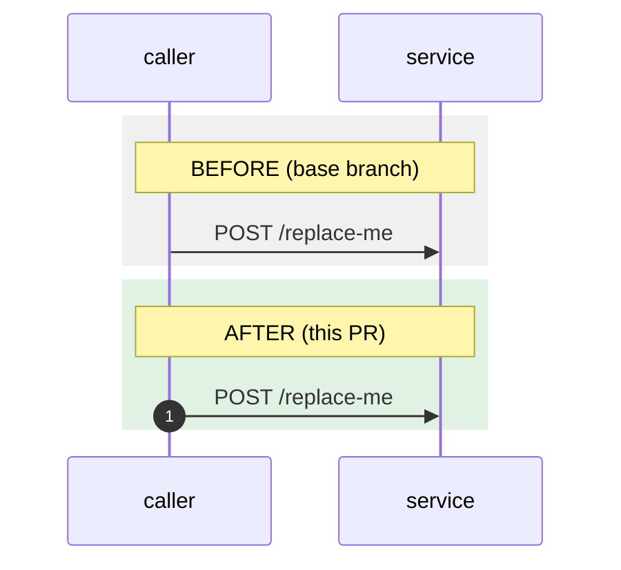

<!--
The reviewer reads this before the diff: show the change, don't retell it. Same sections, same order, under ~250
words outside the diagram (2u-linear:code-standards, "The pull request description"). The "PR description" check
fails without the Flow section, without the Skills line, or, in a repository with screens, without pictures when
screen code changed.
-->

Fixes [2U-0000](https://linear.app/2ulaundry/issue/2U-0000) — what changes, in one sentence.

## Flow

<!--
When the change adds, removes or reorders a call between things that deploy separately or live outside our code
(an app, a service, a Cloud Task, a Kafka topic, Stripe, Iterable, Expo push): BEFORE and AFTER over the same
participants in the same order, each arrow labelled with the real endpoint, topic or function. A new flow has only
AFTER. Otherwise, replace the diagram with the line: No flow change.
-->

## Before / After

<!--
Any change a customer or teammate can see: the same screen, account and state on the base branch and on this
branch, so the only difference is the code. A recording works for a flow. Environment and account ID, plus the
platform in a phone app (iPhone or Android, simulator or device); never names, emails or phone numbers. Otherwise,
or in a repository with no screens, replace the table with the line: No visible change.
-->

|                                 | Before (base branch) | After (this PR) |
| ------------------------------- | -------------------- | --------------- |
| Environment, account ID, screen |                      |                 |

## Decisions

<!-- Two to four: "X rather than Y, because Z", and the cost accepted. What a reviewer would argue about. -->

-

## What it doesn't change

<!-- What a reviewer might fear this touches and it doesn't: deploys, other markets, other callers, rows already written. -->

## Verified

<!-- What you ran or watched, and where: environment, account IDs, order IDs. Evidence, not a checklist. -->

<!-- Claude's 2u-linear plugin writes this line when it opens the PR. By hand, with no skills, leave it as it is. -->
Skills: none
